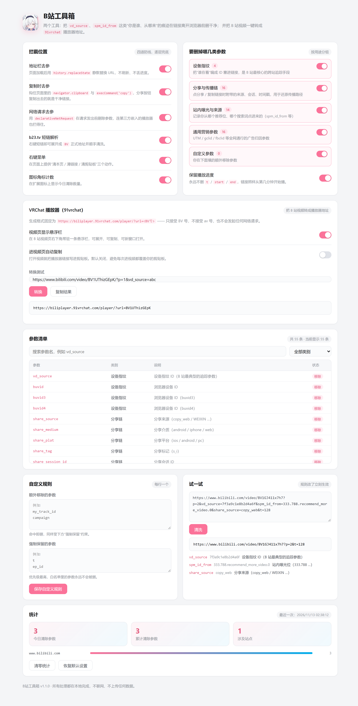
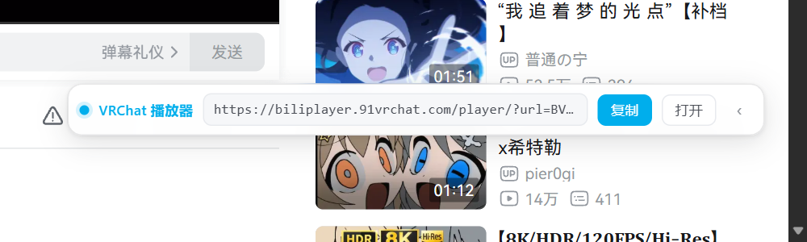

# B站工具箱

给 B 站加两个小工具，一个 Chrome / Edge 扩展（Manifest V3）。

| 工具 | 做什么 |
|---|---|
| **清链** | 自动删掉 B 站链接里的追踪参数（`vd_source`、`spm_id_from` 等） |
| **VRChat 播放器** | 把 B 站视频一键转成 `91vrchat` 播放器地址 |



## 安装

1. 下载本仓库（`Code` → `Download ZIP`，或 `git clone`）
2. 打开 `edge://extensions` 或 `chrome://extensions`
3. 打开右上角「开发者模式」
4. 点「加载解压缩的扩展」，选择**本仓库的根目录**

> 根目录下的 `manifest.json` 就是扩展入口，选对了就能直接加载。

---

## 工具一：清链

`vd_source` 是 B 站最典型的跨站追踪手段：它把设备指纹编进 URL，你每分享一次，对方就能确认是谁发出来的。这个工具在链接离开浏览器之前把这一层删干净。

### 它删什么

按用途分四组，默认全开，可单独关掉：

| 分组 | 数量 | 典型参数 | 为什么要删 |
|---|---|---|---|
| 设备指纹 | 4 | `vd_source` `buvid` `buvid3` `buvid4` | 把「谁在看」编成 ID，跨站也能对上同一个人 |
| 分享与传播链 | 16 | `share_source` `share_medium` `bbid` `unique_k` | 还原一条链接被转发过几次、经过谁 |
| 站内曝光与来源 | 14 | `spm_id_from` `from_source` `spm` `seid` | 记录你从哪个推荐位、哪个搜索词点进来 |
| 通用营销参数 | 16 | `utm_*` `gclid` `fbclid` `msclkid` | 全网通行的广告归因 |

另外按前缀匹配 `utm_` `share_` `spm_` `from_` `vd_`，覆盖未来新增的同族参数。

### 它绝不删什么

这是设计上最重要的一条。以下参数直接决定「打开哪一集、第几个分 P、从第几秒开始播」，删了就毁掉链接：

`p` `page` `t` `start` `end` `ep_id` `cid` `aid` `bvid` `oid` `season_id` `keyword` `order` `sort` `tab` …

「保留播放进度」开关默认开启，即使关掉设备指纹等分组，`t` / `start` / `end` 也依然保留。

### 四道防线

1. **网络层**（`declarativeNetRequest`）— 请求发出前用 `queryTransform` 删参数，连第三方页面里嵌入的 B 站播放器都拦得住。
2. **地址栏**（钩 `history.pushState/replaceState`）— 静默替换 URL，**不刷新、不丢播放进度**，SPA 路由切换同样生效。
3. **复制**（钩 `navigator.clipboard` 与 `execCommand('copy')`）— 页面里点「复制链接」，落进剪贴板的就是干净链接。
4. **右键 / 弹窗** — 手动兜底：清本页、清链接、清剪贴板、解析 `b23.tv` 短链。

---

## 工具二：VRChat 播放器

把 B 站视频转成 91vrchat 的播放器地址，直接粘进 VRChat 视频播放器：

```
https://biliplayer.91vrchat.com/player/?url=BV1UThizGEpK
```

只接受 **BV 号**（`BV` + 10 位），不接受 av 号。整个转换是纯字符串计算，**不发起任何网络请求**。

### 三种用法

**1. 悬浮栏（主要用法）**

打开任意 B 站视频页，右下角会出现一条悬浮栏，自动填好播放器链接。

- 默认折叠成小胶囊，不遮挡播放器控件；点 `‹` 展开
- 拖动选中 URL 或点「复制」
- 点「打开」在新标签页打开播放器页面



**2. 弹窗**

扩展图标 → 「VRChat 播放器」标签页，自动显示当前视频，也支持手动粘贴链接 / BV 号转换。


**3. 右键菜单**

视频页或视频链接上右键 → 「生成 VRChat 播放器链接」，直接复制到剪贴板。

### 支持的输入

```
BV1UThizGEpK
bv1UThizGEpK                                        （前缀大小写不敏感）
https://www.bilibili.com/video/BV1UThizGEpK/
https://www.bilibili.com/video/BV1UThizGEpK/?p=2&vd_source=abc
https://m.bilibili.com/video/BV1UThizGEpK
https://www.bilibili.com/list/watchlater?bvid=BV1UThizGEpK
去看 https://www.bilibili.com/video/BV1UThizGEpK/ 这个   （分享文案里夹着）
https://biliplayer.91vrchat.com/player/?url=BV1UThizGEpK   （幂等，重复转换结果一致）
```

不支持的会给出可读原因：`av` 号页面提示「只接受 BV 号」，`b23.tv` 短链提示「请先展开短链」。

---

## 文件结构

```
manifest.json           扩展入口（MV3）
background.js           Service Worker：DNR 规则、右键菜单、短链解析、角标
offscreen.html/js       MV3 写剪贴板必须借 offscreen 文档
shared/
  clean.js              清链引擎，一份代码三处运行
  store.js              设置与统计存储
  vrchat.js             BV 号抽取与播放器链接拼接
content/
  bridge.js             ISOLATED world：接 MAIN world 请求
  page-main.js          MAIN world：钩 history / clipboard
  vrchat-bar.js         视频页右下角悬浮栏
popup/                  弹窗（两个 tab）
options/                设置页
icons/                  16 / 32 / 48 / 128
```

`clean.js` 与 `vrchat.js` 都用 UMD 包装，同一份源码在 Service Worker（ES module）、内容脚本（classic script）和页面里都能跑，不存在两套实现互相漂移的问题。

## 开发提示

- **manifest 里的路径相对 `manifest.json` 所在目录**。写错会让扩展整个加载失败，而且只在 `--enable-logging` 的 stderr 里有一行报错，很容易漏。
- **B 站自己会改地址栏**。页面加载后它的 JS 会通过 `historyApi` 把整个 `?query` 抹掉，所以「最终地址里还有没有 `p`/`t`」不能用来判断本扩展是否生效。
- **`history.pushState` 会被层层包装**。B 站在本扩展之后又包了一层，所以不能靠检查函数源码判断钩子是否生效，只能做行为测试。
- **BV 号是 12 字符**（`BV` + 10 位）。

## 隐私

所有处理在本地完成：不联网、不上报、没有分析埋点。统计只存在 `chrome.storage.local`，记录清除数量与域名，不含 URL 内容。

唯一会发网络请求的功能是你主动点「解析 b23.tv 短链」时，去取那条短链的跳转目标。VRChat 链接转换是纯字符串拼接，不触网。

## License

[MIT](LICENSE)
